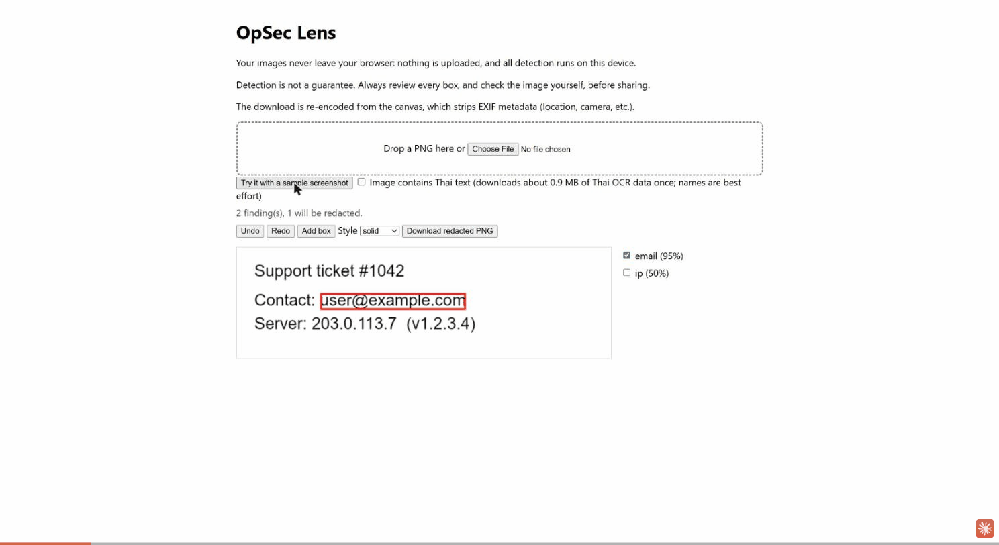
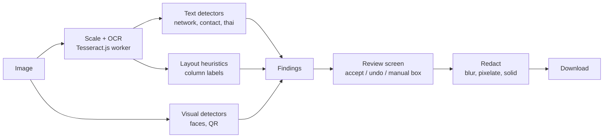

# OpSec Lens

Finds what makes a screenshot unsafe to share, even when it isn't a password (an organisation's IPs,
hostnames, IDs, faces), blurs it in your browser, and is measured on a public benchmark.

**Live:** `<LIVE_URL>` (click "Try it" for a synthetic sample)



## Why

On 7 Nov 2026 I found that a screenshot on my own portfolio showed real public IP addresses belonging
to my university's network, in a SIEM-style alerts table. It contained no password or API key, so
secret scanners would not have caught it. OpSec Lens is the tool that would have.

## What it does

1. Drop a screenshot. OCR (Tesseract, English + Thai) reads the text.
2. Rule-based detectors find emails, phones, IPs (public and internal), hostnames, URLs, tokens and
   Thai national IDs; IP addresses are labelled with their owning organisation from a bundled table.
3. Layout heuristics redact whole table columns headed "Source IP", "Username" and similar.
4. Faces and QR codes are found with small in-browser models.
5. A review screen lets you accept or undo each box, add boxes by hand, pick a redaction style, and
   download the blurred image.

**Privacy:** everything runs in the browser. Images and extracted text are never sent anywhere; all
model and data files are self-hosted and same-origin. An end-to-end test asserts no image data leaves
the page.

## Architecture



One module per detector family under `src/detectors/`; OCR in `src/ocr.ts`; redaction in
`src/redact.ts`; review UI in `src/review/`.

## Results

Synthetic benchmark: 300 generated screenshots (terminals, dashboards, SIEM tables, chats, forms)
with planted private data, plus 60 negatives. Reproduce with `npm run benchmark:generate` and
`npm run benchmark:score`. Full per-detector tables are in [`benchmark/results.md`](benchmark/results.md).

| Method | Recall | Precision | Fully covered |
|---|---|---|---|
| rules-only | 69.2% | 76.6% | 69.8% |
| rules + heuristics | 69.2% | 64.3% | 82.1% |

"Fully covered" means at least 95% of a labelled item is hidden by the union of findings. The
heuristics trade precision for coverage, which is the right trade for a redaction tool.

I also ran an offline spike with a local vision-language model (`gemma3:12b`, 60-image subset).
Combining it with the rules raised recall slightly (73.8% vs 70.5%) but cut precision to 36.9% and took
a median 8.4 s per image, so it is not shipped. See [`benchmark/results-vlm.md`](benchmark/results-vlm.md).

## Limitations

- **Not a guarantee.** OCR misses text; recall is about 70% per item. Always check the review screen
  before sharing.
- Thai names are best effort; Thai IDs and phone numbers are rule-based and more reliable.
- Licence plates are **not** detected: no small, permissively licensed plate model was available
  (decision in `issues/done/016-licence-plates-decision.md`).
- IP-to-organisation labels come from a trimmed, build-time snapshot of public data and can be stale.
- The benchmark is synthetic; real screenshots will differ.
- Video is out of scope for v1.

## What I learned

- OCR quality, not the rules, is the ceiling for recall; image scaling and a Thai language pack mattered
  more than regex tweaks.
- Measure the trade-off you are actually making: for redaction, coverage beats precision, and the
  benchmark needed a "fully covered" metric to show it.
- A bigger model was not better: the VLM added noise and latency for a small recall gain.
- Privacy claims should be tested, not asserted: the e2e test watches the network.

## Development

```
npm install
npm run dev          # local app
npm test             # unit tests
npm run typecheck
npm run e2e          # Playwright
```

All test and benchmark data is synthetic and generated by scripts in this repo. Example IPs use
documentation ranges and example domains use `example.com` / `.test`. See `DATA-SOURCES.md` for
third-party data and licences.
